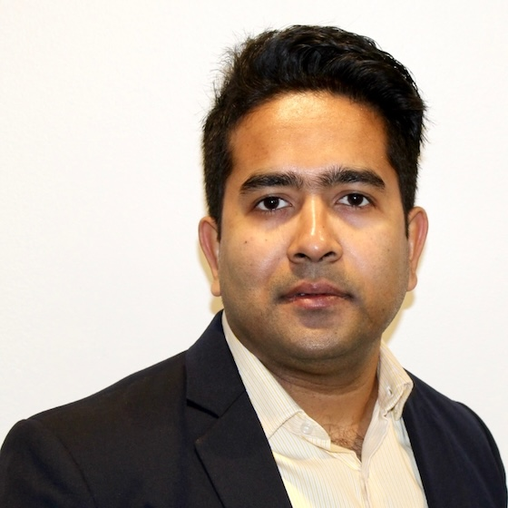

::: {.wrap}

::: {.about-grid}
::: {.portrait}
<figure class="portrait-frame"></figure>

<b>Mohammad Rafiqul Islam</b>
Postdoctoral Research Associate 
Department of Mathematics, Iowa State University 
[Carver Hall, Room 461](https://maps.app.goo.gl/AXzBwijj2KkxnFDK9) · 411 Morrill Road, Ames, IA 50011 
[mri@iastate.edu](mailto:mri@iastate.edu)

<a class="btn-r" href="https://www.linkedin.com/in/mohammad-rafiqul-islam/"><i class="bi bi-linkedin"></i> LinkedIn</a>
<a class="btn-r" href="https://youtube.com/@quanttube"><i class="bi bi-youtube"></i> QuantTube</a>

:::

::: {}
::: {.prose}
I am a postdoctoral research associate in probability theory in the Mathematics Department at Iowa State University, where I work with [David P. Herzog](https://faculty.sites.iastate.edu/dherzog/). I earned my Ph.D. in Mathematics from Florida State University in summer 2026 under the supervision of [Lingjiong Zhu](https://www.math.fsu.edu/DepartmentNews/Articles/Fac_Zhu.math). My dissertation is *Advances in Langevin Algorithms for Decentralized, Constrained, and Accelerated Sampling*.

I hold a B.S. in Mathematics from the [University of Dhaka](https://www.du.ac.bd), with minors in statistics, physics, and computer science, and an integrated master's in Applied Mathematics from the same university. During my master's I passed several professional exams from the [Institute and Faculty of Actuaries (IFoA)](https://www.ifoa.org.uk), equivalent to the Society of Actuaries' Exams P, FM, and Life Contingencies. I then spent two years in the Bangladeshi life-insurance industry, pricing products, computing reserves, and working with consulting actuaries on actuarial valuations.

In 2018 I moved to the United States for a second master's, in mathematics with a focus on statistics and data analytics, at [Youngstown State University](https://www.ysu.edu) in Ohio. Along the way I became more and more drawn to data science, machine learning, and the mathematics underneath them. That interest led to a Ph.D. in theoretical machine learning, and from there to my current work on stochastic dynamics and sampling.
:::

<h2 style="font-size:1.35rem;margin:2.6rem 0 1.2rem">The path so far</h2>
<ol class="path">
<li class="here"><time>2026 –</time>
<b>Postdoctoral Research Associate</b>Iowa State University · probability, with David P. Herzog
</li>
<li><time>2021 – 26</time>
<b>Ph.D. in Mathematics</b>Florida State University · advised by Lingjiong Zhu
</li>
<li><time>2018 – 20</time>
<b>M.S. in Mathematics</b>Youngstown State University · statistics &amp; data analytics; SOA Exams P and FM
</li>
<li><time>2016 – 18</time>
<b>Life insurance industry</b>Sandhani Life (actuarial trainee executive), then Delta Life (assistant vice president), Dhaka
</li>
<li><time>2014 – 16</time>
<b>B.S. Mathematics &amp; M.S. Applied Mathematics</b>University of Dhaka · IFoA professional exams
</li>
</ol>

<h2 style="font-size:1.35rem;margin:2.6rem 0 1.2rem">Beyond the papers</h2>
::: {.card-grid}
::: {.card}
Video
<h3>[QuantTube](https://youtube.com/@quanttube)</h3>

A YouTube channel for mathematical and quantitative topics.

:::
::: {.card}
Off the clock
<h3>Bamboo flute</h3>

An enthusiastic amateur. I speak Bengali natively and English fluently.

:::
:::
:::
:::
:::

