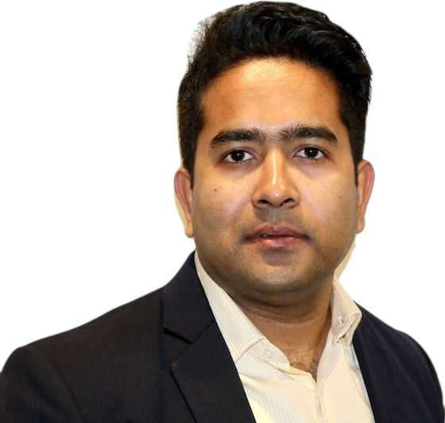
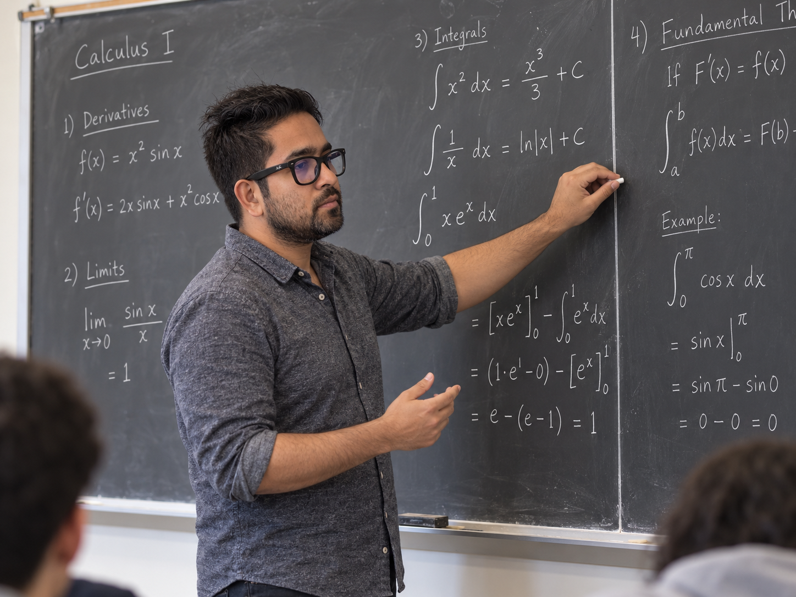

::: {.wrap}
::: {.home-hero}
::: {.hero-text}
<h1>Mohammad Rafiqul Islam</h1>

<b>Postdoctoral Research Associate</b> · Iowa State University 

I design and analyze Langevin algorithms: Markov chain Monte Carlo methods for sampling high-dimensional distributions across networks of agents, inside constrained domains, and at higher orders of accuracy. At Iowa State I work with David&nbsp;P.&nbsp;Herzog. I earned my Ph.D. at Florida State University in 2026, advised by Lingjiong&nbsp;Zhu.

<a class="btn-r solid" href="research.qmd">Research &amp; papers <i class="bi bi-arrow-right"></i></a>
<a class="btn-r solid" href="_assets/documents/CV.pdf"><i class="bi bi-file-earmark-text"></i> CV (PDF)</a>
<a class="btn-r solid" href="mailto:mri@iastate.edu"><i class="bi bi-envelope"></i> Email</a>

<i class="bi bi-geo-alt"></i> Carver Hall 461, Ames, IA
<i class="bi bi-mortarboard"></i> <a href="https://scholar.google.com/citations?user=gTz5r68AAAAJ&hl=en">Google Scholar</a>
<i class="bi bi-github"></i> <a href="https://github.com/rispace">GitHub</a>

:::

<figure class="portrait-arch"></figure>
:::
:::

::: {.band}
::: {.wrap}
::: {.band-head}
<h2>Research Spotlight</h2>
<a class="text-link" href="research.qmd">All research</a>
:::

::: {.theme-grid}
::: {.theme-card}

I.current · 2026

<h3>Constrained dynamics with singular repulsion</h3>

Collision-free stochastic particle systems inside a constrained domain, and numerical schemes that stay stable near the singularity without creating artificial collisions. Joint work with D.&nbsp;P.&nbsp;Herzog.

<a href="research/singular-langevin/" target="_blank">Project overview</a>

:::

::: {.theme-card}

II.2024 – 2026

<h3>Decentralized Bayesian sampling</h3>

Agents on a network sample a shared posterior without pooling their data. This line of work removes network bias with EXTRA-type corrections and handles convex constraints through proximal regularization.

<a href="research/extrasgld/" target="_blank">Generalized EXTRA SGLD</a><a href="research/dpsgld/" target="_blank">Decentralized Proximal SGLD</a>

:::

::: {.theme-card}

III.2025

<h3>High-order Langevin Monte Carlo</h3>

Samplers built from $P$-th order Langevin dynamics through splitting and accurate integration. Their Wasserstein guarantees depend better on the dimension and the accuracy level as the order grows.

<a href="research/holmc/" target="_blank">High-Order Langevin Monte Carlo</a>

:::
:::
:::
:::

::: {.band .tint}
::: {.wrap}
::: {.two-col}
::: {}
<h2>News</h2>
<ul class="news">
<li><time>sep 2026</time>Talk on <strong>scalable sampling via Langevin dynamics</strong> at the Analysis, Geometry &amp; Probability Seminar, Iowa State.</li>
<li><time>aug 2026</time>Joined <strong>Iowa State University</strong> as a postdoctoral research associate in probability.</li>
<li><time>jul 2026</time>Completed my <strong>Ph.D. at Florida State</strong>: <em>Advances in Langevin Algorithms for Decentralized, Constrained, and Accelerated Sampling.</em></li>
<li><time>apr 2026</time>Received FSU's <strong>Distinguished Teaching Assistant Award</strong> and the <strong>Tam Family Excellence in Graduate Student Research Award</strong>.</li>
</ul>
:::

::: {}
<h2>Selected papers</h2>
<ol class="mini-pubs">
<li><a class="t" href="research/dpsgld/" target="_blank">Decentralized Proximal Stochastic Gradient Langevin Dynamics</a><b>M. R. Islam</b>, L. Zhu · arXiv 2026</li>
<li><a class="t" href="research/holmc/" target="_blank">High-Order Langevin Monte Carlo Algorithms</a>T. L. Dang, M. Gürbüzbalaban, <b>M. R. Islam</b>, N. Yao, L. Zhu · arXiv 2025</li>
<li><a class="t" href="research/extrasgld/" target="_blank">Generalized EXTRA Stochastic Gradient Langevin Dynamics</a>M. Gürbüzbalaban, <b>M. R. Islam</b>, X. Wang, L. Zhu · arXiv 2024</li>
<li><a class="t" href="publication/pub2/" target="_blank">GJR-GARCH Volatility Modeling under NIG and ANN for Predicting Top Cryptocurrencies</a>F. Mostafa, P. Saha, <b>M. R. Islam</b>, N. Nguyen · J. Risk Financial Manag. 2021</li>
</ol>

<a class="text-link" href="research.qmd#publications" target="_blank">Full publication list</a>

:::
:::
:::
:::

::: {.band}
::: {.wrap}
::: {.teach-band}
<figure class="photo-frame"></figure>

::: {}
<h2 style="margin-top:0">Teaching</h2>
<blockquote class="pull">You played a large part in convincing me that I am capable of learning difficult subjects.</blockquote>
Student evaluation, MAP 2302 Ordinary Differential Equations, Summer 2026

I have taught calculus, differential equations, precalculus, and actuarial mathematics since 2018. This fall I lead Calculus III recitations at Iowa State.

<a class="text-link" href="teaching.qmd" target="_blank">Courses &amp; student feedback</a>
:::
:::
:::
:::
