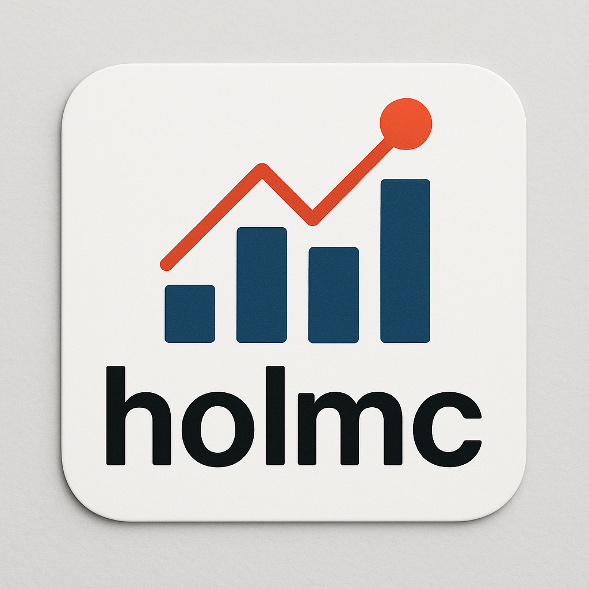

---
title: "Python Package: holmc"
date: 2025-08-14
author: "Rafiq Islam"
collection: portfolio
citation: true
search: true
lightbox: true
image: holmc.png
---  

{width="250" height="250"}

A Higher-Order Langevin Monte Carlo Sampler for Bayesian Learning

Holmc provides third- and fourth-order Langevin MCMC samplers designed for efficient sampling in Bayesian regression and classification problems. The detail of the package can be found <a href="https://rispace.github.io/higher-order-Langevin-dynamics/" target="_blank">here</a>  

```{=html}
<div class="share-row"><span>Share:</span><a href="https://www.facebook.com/sharer.php?u=https://rispace.github.io/portfolio/spd/holmc/"><i class="bi bi-facebook"></i> Facebook</a><a href="https://www.linkedin.com/sharing/share-offsite/?url=https://rispace.github.io/portfolio/spd/holmc/"><i class="bi bi-linkedin"></i> LinkedIn</a><a href="https://twitter.com/intent/tweet?url=https://rispace.github.io/portfolio/spd/holmc/"><i class="bi bi-twitter"></i> Twitter</a></div>
```
<script src="https://giscus.app/client.js"
        data-repo="rispace/rispace.github.io"
        data-repo-id="R_kgDOPdB7AQ"
        data-category="Ideas"
        data-category-id="DIC_kwDOPdB7Ac4CuMVL"
        data-mapping="pathname"
        data-strict="0"
        data-reactions-enabled="1"
        data-emit-metadata="0"
        data-input-position="bottom"
        data-theme="light"
        data-lang="en"
        crossorigin="anonymous"
        async>
</script>
 
<div id="fb-root"></div>
<script async defer crossorigin="anonymous"
 src="https://connect.facebook.net/en_US/sdk.js#xfbml=1&version=v20.0"></script>
<div class="fb-comments" data-href="https://rispace.github.io/portfolio/spd/holmc/" data-width="750" data-numposts="5"></div>