::: {.wrap}
::: {.r-head}
::: {}
<h1>Research</h1>

Many questions in statistics and machine learning come down to drawing random samples from a complicated probability distribution. I study Langevin algorithms, which are Markov chain Monte Carlo methods that do this by simulating a random walk guided by the shape of the distribution. My work proves how quickly these samplers converge and designs versions that scale to networks of computers, respect constraints, and use higher-order dynamics to move faster.

<ul class="r-areas">
<li>I
<b>Decentralized sampling.</b> Agents on a network learn a shared posterior without pooling their data.
</li>
<li>II
<b>Constrained and singular dynamics.</b> Samplers that stay inside a domain and avoid collisions.
</li>
<li>III
<b>High-order Langevin Monte Carlo.</b> Faster mixing from higher-order dynamics, with Wasserstein guarantees.
</li>
<li>IV
<b>Financial engineering.</b> Time-series prediction, derivative pricing, and risk.
</li>
</ul>  

:::

<h2>At a glance</h2>

<b>5</b>papers

<b>8</b>talks

<b>4</b>mentees

<ul class="profiles-list">
<li><a href="https://scholar.google.com/citations?user=gTz5r68AAAAJ&hl=en"><i class="bi bi-mortarboard-fill"></i>Google Scholarcitations &amp; papers→</a></li>
<li><a href="https://orcid.org/0000-0002-4376-8971"><i class="bi bi-person-vcard"></i>ORCID0000-0002-4376-8971→</a></li>
<li><a href="https://www.researchgate.net/profile/Mohammad-Rafiqul-Islam-5"><i class="bi bi-journal-richtext"></i>ResearchGatepublications &amp; discussions→</a></li>
<li><a href="https://github.com/rispace"><i class="bi bi-github"></i>GitHubgithub.com/rispace→</a></li>
</ul>

:::
:::

::: {.band .tint}
::: {.wrap}
::: {.band-head}

<h2 id="how-it-works">How a Langevin sampler works</h2>

A short, hands-on introduction for anyone new to the topic.

:::

Suppose we want random numbers whose histogram follows a given curve. In this example the target is a mixture of two familiar bell curves (normal distributions), one centred at $-1$ that holds 60% of the probability and one centred at $1.2$ that holds the other 40%:

$$\pi(x) \;=\; 0.6\cdot\frac{1}{0.7\sqrt{2\pi}}\,e^{-\frac{(x+1)^2}{2(0.7)^2}} \;+\; 0.4\cdot\frac{1}{0.6\sqrt{2\pi}}\,e^{-\frac{(x-1.2)^2}{2(0.6)^2}} .$$

We can write this formula down and evaluate it at any point, but there is no direct way to draw random numbers from it. A Langevin sampler gets around this with walkers that take small random steps guided by the shape of $\pi$.

::: {.steps3}
::: {.step3}
1
<h3>Turn probability into a landscape</h3>

Define the height $U(x) = -\log \pi(x)$. Where $\pi$ is large, $U$ is low, so likely values become valleys and unlikely values become hills.

:::
::: {.step3}
2
<h3>Roll downhill, with random kicks</h3>

At every step each walker takes a small step downhill and then gets a random push. The pull keeps it near likely values, and the kicks keep it from settling in one place.

:::
::: {.step3}
3
<h3>Record where it has been</h3>

Every position a walker visits is one sample. With the right balance of pull and kicks, the histogram of all the samples settles onto $\pi(x)$.

:::
:::

<canvas id="langevin-demo" aria-label="Interactive demonstration: on the left, walkers move on the landscape U(x); on the right, a histogram of their positions builds up and approaches the target curve"></canvas>

step 0 · 0 samples
<button type="button" data-demo-toggle aria-pressed="true">Pause</button><button type="button" class="kick" data-demo-kick aria-pressed="true">Random kicks: on</button><button type="button" data-demo-reset>Restart</button>

Thirty walkers start high on the right-hand slope. Watch them roll into the valleys while the histogram fills in.

::: {.demo-foot}
::: {.math-card}

<b>The update rule.</b> With step size $h = 0.03$ and a fresh standard normal draw $\xi_k$ for each walker,

$$x_{k+1} = x_k \;\underbrace{-\,h\,U'(x_k)}_{\text{downhill pull}} \;+\; \underbrace{\sqrt{2h}\,\xi_k}_{\text{random kick}} .$$

<b>How many samples?</b> The demo runs 30 walkers side by side. Each step moves every walker once and records its new position, so each step adds <b>30 samples</b>, and after $k$ steps the histogram holds $30k$.

:::

::: {}

Turn the kicks off and every walker stops at the bottom of its nearest valley. That is gradient descent: it finds a single best point but loses the spread of the distribution. With the kicks on, the walkers keep exploring and occasionally cross the hill between the valleys, so each valley ends up with its correct share: about 60% on the left and 40% on the right.

My research asks how quickly this happens, and how to keep it fast and accurate in high dimensions, across networks of computers, and inside constrained regions.

:::
:::
:::
:::

::: {.band}
::: {.wrap}
::: {.band-head}

<h2>Current project</h2>

:::

<article class="project">
<a class="pmedia" href="research/singular-langevin/">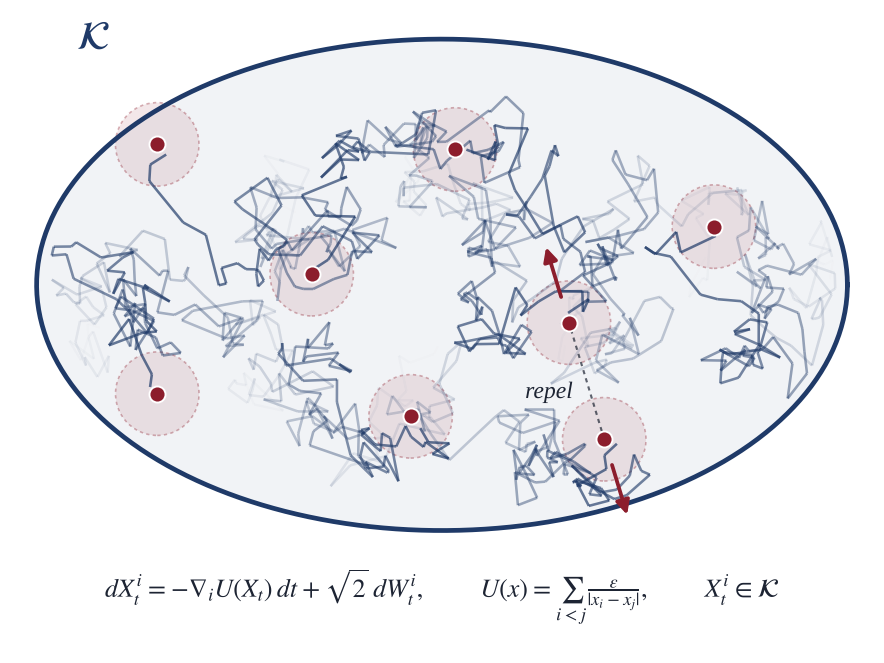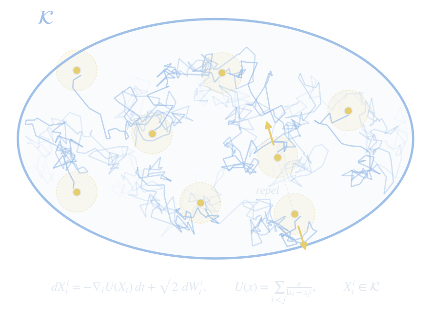</a>

In progress · 2026
<h3><a href="research/singular-langevin/">Constrained Langevin Dynamics with Singular Repulsion</a></h3>

With David P. Herzog, Iowa State University

Particles diffuse inside a bounded region while strongly repelling one another at short range. Standard numerical steps can push them toward collisions, and projecting back can create collisions of its own. We are developing a tamed-proximal Langevin scheme that handles the singular repulsion directly while respecting the boundary, with guarantees on stability, collision avoidance, and convergence.

<ul class="chips"><li>Well-posedness</li><li>Invariant measures</li><li>Stable discretization</li></ul><a class="text-link" href="research/singular-langevin/">Project overview</a>

</article>
:::
:::

::: {.band .tint}
::: {.wrap}
::: {.band-head}

<h2 id="publications">Publications &amp; preprints</h2>

<a class="text-link" href="https://scholar.google.com/citations?user=gTz5r68AAAAJ&hl=en">Google Scholar</a>
:::

::: {.pubs}

<article class="pub">

2026Preprint<a class="pub-thumb" href="research/dpsgld/">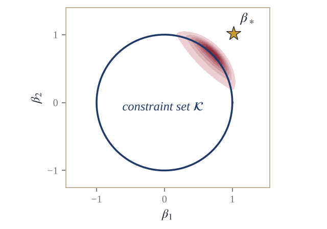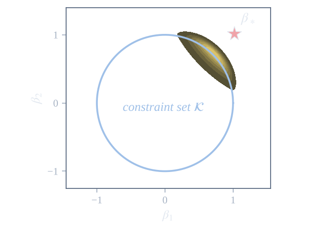</a>

<h3><a href="research/dpsgld/">Decentralized Proximal Stochastic Gradient Langevin Dynamics</a></h3>

<b>Mohammad Rafiqul Islam</b> and Lingjiong Zhu

arXiv:2605.00723

A decentralized sampler for log-concave distributions on convex domains. A shared proximal regularization based on the Moreau–Yosida envelope lets agents respect the constraint without exchanging private data. Non-asymptotic 2-Wasserstein guarantees cover both individual agents and network averages and quantify the bias introduced by the proximal approximation.

<a href="https://arxiv.org/pdf/2605.00723">PDF</a><a href="https://arxiv.org/abs/2605.00723">arXiv</a>

BibTeX

<pre id="bib-dpsgld">@article{islam2026depsgld,
  title={Decentralized Proximal Stochastic Gradient Langevin Dynamics},
  author={Islam, Mohammad Rafiqul and Zhu, Lingjiong},
  journal={arXiv preprint arXiv:2605.00723},
  year={2026}
}</pre><button class="bibtex-copy" data-copy-target="bib-dpsgld" type="button">Copy</button>

</article>

<article class="pub">

2025Preprint<a class="pub-thumb" href="research/holmc/">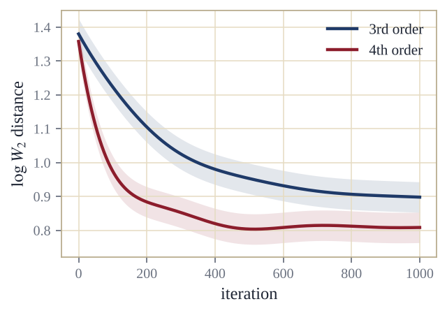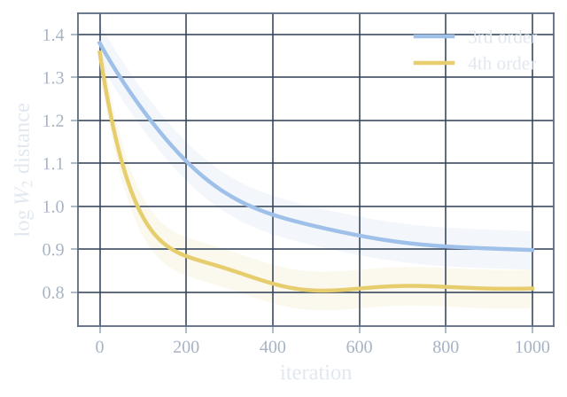</a>

<h3><a href="research/holmc/">High-Order Langevin Monte Carlo Algorithms</a></h3>

Thanh L. Dang, Mert Gürbüzbalaban, <b>Mohammad Rafiqul Islam</b>, Nian Yao, and Lingjiong Zhu

arXiv:2508.17545

Langevin Monte Carlo algorithms built from third- and higher-order dynamics by combining splitting with accurate integration. The convergence guarantees improve their dependence on dimension and target accuracy as the order grows, and numerical experiments confirm the efficiency of the higher-order approach.

<a href="_assets/documents/2508.17545v1.pdf">PDF</a><a href="https://arxiv.org/abs/2508.17545">arXiv</a>

BibTeX

<pre id="bib-holmc">@article{dang2025highorder,
  title={High-Order Langevin Monte Carlo Algorithms},
  author={Dang, Thanh L. and Gurbuzbalaban, Mert and Islam, Mohammad Rafiqul and Yao, Nian and Zhu, Lingjiong},
  journal={arXiv preprint arXiv:2508.17545},
  year={2025}
}</pre><button class="bibtex-copy" data-copy-target="bib-holmc" type="button">Copy</button>

</article>

<article class="pub">

2024Preprint<a class="pub-thumb" href="research/extrasgld/">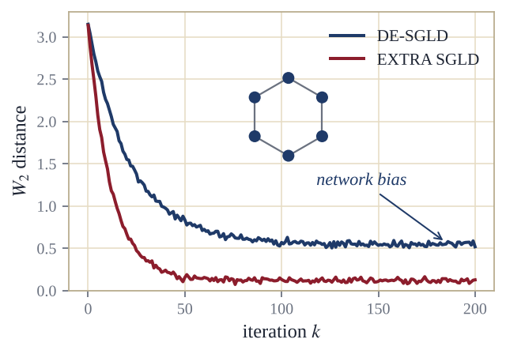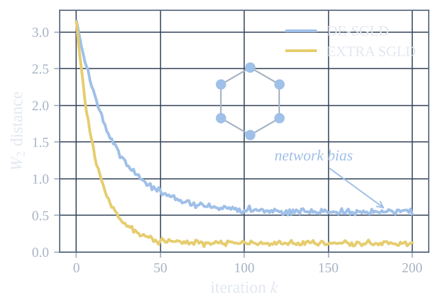</a>

<h3><a href="research/extrasgld/">Generalized EXTRA Stochastic Gradient Langevin Dynamics</a></h3>

Mert Gürbüzbalaban, <b>Mohammad Rafiqul Islam</b>, Xiaoyu Wang, and Lingjiong Zhu

arXiv:2412.01993

Decentralized stochastic-gradient Langevin methods carry a persistent network bias. Inspired by EXTRA-type optimization, the proposed sampler removes that bias in the full-batch setting and gives sharper mini-batch bounds, so agents can learn a Bayesian model together without centralizing their data.

<a href="_assets/documents/2412.01993v1.pdf">PDF</a><a href="https://arxiv.org/abs/2412.01993">arXiv</a>

BibTeX

<pre id="bib-extra">@article{gurbuzbalaban2024extra,
  title={Generalized EXTRA Stochastic Gradient Langevin Dynamics},
  author={Gurbuzbalaban, Mert and Islam, Mohammad Rafiqul and Wang, Xiaoyu and Zhu, Lingjiong},
  journal={arXiv preprint arXiv:2412.01993},
  year={2024}
}</pre><button class="bibtex-copy" data-copy-target="bib-extra" type="button">Copy</button>

</article>

<article class="pub">

2021Journal<a class="pub-thumb" href="publication/pub2/">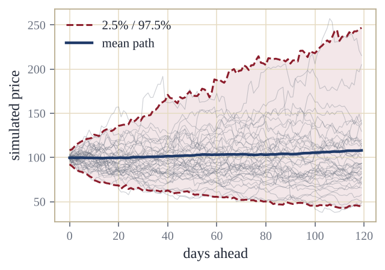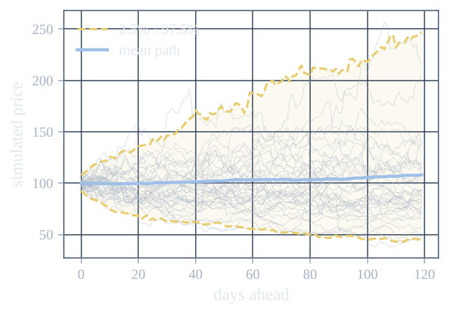</a>

<h3><a href="publication/pub2/">GJR-GARCH Volatility Modeling under NIG and ANN for Predicting Top Cryptocurrencies</a></h3>

Fahad Mostafa, Pritam Saha, <b>Mohammad Rafiqul Islam</b>, and Nguyet Nguyen

Journal of Risk and Financial Management 14(9), 421

Combines GJR-GARCH volatility modeling, Monte Carlo simulation, value-at-risk backtesting, and neural networks to study ten major cryptocurrencies. The models capture asymmetric volatility and tail risk, and the neural-network forecasts track market prices closely.

<a href="publication/pub2/paper2.pdf">PDF</a><a href="https://doi.org/10.3390/jrfm14090421">DOI</a>

BibTeX

<pre id="bib-crypto">@article{mostafa2021gjr,
  title={GJR-GARCH Volatility Modeling under NIG and ANN for Predicting Top Cryptocurrencies},
  author={Mostafa, Fahad and Saha, Pritam and Islam, Mohammad Rafiqul and Nguyen, Nguyet},
  journal={Journal of Risk and Financial Management},
  volume={14}, number={9}, pages={421}, year={2021},
  doi={10.3390/jrfm14090421}
}</pre><button class="bibtex-copy" data-copy-target="bib-crypto" type="button">Copy</button>

</article>

<article class="pub">

2020Journal<a class="pub-thumb" href="publication/pub1/">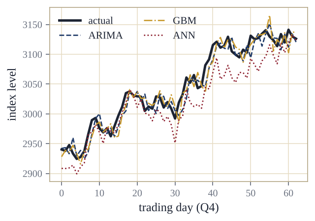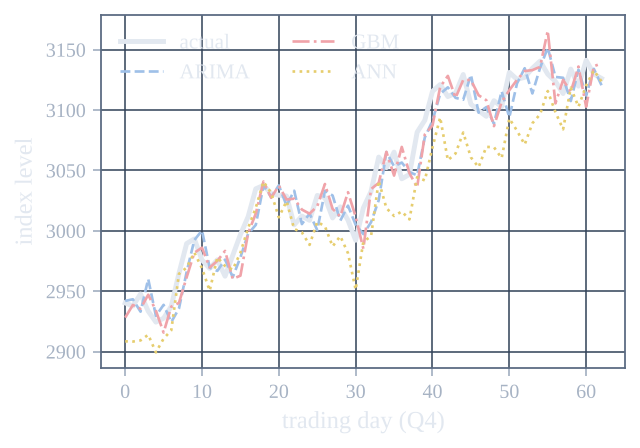</a>

<h3><a href="publication/pub1/">Comparison of Financial Models for Stock Price Prediction</a></h3>

<b>Mohammad Rafiqul Islam</b> and Nguyet Nguyen

Journal of Risk and Financial Management 13(8), 181

Compares ARIMA, artificial neural networks, and geometric Brownian motion on historical daily stock prices. For next-day prediction, the classical statistical and stochastic models approximate observed prices more closely than the neural network does.

<a href="publication/pub1/paper1.pdf">PDF</a><a href="https://doi.org/10.3390/jrfm13080181">DOI</a>

BibTeX

<pre id="bib-stock">@article{islam2020comparison,
  title={Comparison of Financial Models for Stock Price Prediction},
  author={Islam, Mohammad Rafiqul and Nguyen, Nguyet},
  journal={Journal of Risk and Financial Management},
  volume={13}, number={8}, pages={181}, year={2020},
  doi={10.3390/jrfm13080181}
}</pre><button class="bibtex-copy" data-copy-target="bib-stock" type="button">Copy</button>

</article>

:::
:::
:::

::: {.band}
::: {.wrap}
::: {.band-head}

<h2 id="talks">Talks &amp; presentations</h2>

:::

<ul class="talks">
<li><time>Sep 9, 2026</time>
<a class="t" href="talks/2026-09-09-isu-agp.html">Scalable Sampling Algorithms via Langevin Dynamics</a>Analysis, Geometry and Probability Seminar · Iowa State University
Seminar</li>
<li><time>Mar 28, 2026</time>
<a class="t" href="talks/2026-03-28-ams.html">Decentralized Constrained Sampling via Proximal Stochastic Langevin Dynamics</a>AMS Spring Eastern Sectional Meeting · Boston College, MA
Contributed</li>
<li><time>Mar 3, 2026</time>
<a class="t" href="talks/2026-03-03-icerm.html">Generalized EXTRA SGLD: Eliminating Network Bias in Decentralized Bayesian Learning</a>Bayesian Inverse Problems &amp; UQ · ICERM, Brown University
Poster</li>
<li><time>Jan 30, 2026</time>
<a class="t" href="talks/2026-01-30-gradseminar.html">High-Order and Bias-Free Distributed Langevin Dynamics for Scalable Bayesian Inference</a>Department of Mathematics · Florida State University
Talk</li>
<li><time>Nov 20, 2023</time>
<a class="t" href="talks/2023-11-20-candi.html">The Heavy-Tail Phenomenon in Decentralized Stochastic Gradient Descent</a>Department of Mathematics · Florida State University
Candidacy</li>
<li><time>Oct 5, 2023</time>
<a class="t" href="talks/2023-10-05-st-op.html">Decentralized Stochastic Gradient Langevin Dynamics and Hamiltonian Monte Carlo</a>Department of Mathematics · Florida State University
Talk</li>
<li><time>Dec 2, 2022</time>
Asymptotics and Calibration of Local Volatility ModelsDepartment of Mathematics · Florida State University
Talk</li>
<li><time>Apr 28, 2020</time>
<a class="t" href="talks/2020-04-26-project.html">Sensitivity Analysis for Monte Carlo and Quasi-Monte Carlo Option Pricing</a>Department of Mathematics &amp; Statistics · Youngstown State University
Talk</li>
</ul>
:::
:::

::: {.band .tint}
::: {.wrap}
::: {.band-head}

<h2 id="mentoring">Undergraduate research</h2>

I have mentored undergraduates at Florida State through two research programs.

:::

::: {.card-grid}
::: {.card}
UROP · 2025 – 2026
<h3>Machine learning and Florida traffic fatalities</h3>

[Sarah Thapa](https://www.linkedin.com/in/sarah-thapa-4aa751318/): predictive models for factors associated with Florida road crashes and the economic impact of crash-related casualties.

:::

::: {.card}
UROP · 2025 – 2026
<h3>Machine learning vs. Black–Scholes–Merton</h3>

[Aiden Marin](https://www.linkedin.com/in/aiden-marin/): comparing classical Black–Scholes–Merton pricing with modern machine-learning models for options on different underlying stocks.

:::

::: {.card}
Directed Reading Program · 2024 – 2025
<h3>Identifying spam and non-spam emails</h3>

[Lily Kinney](https://www.linkedin.com/in/lily-g-kinney/) and [Kiera Agic](https://www.linkedin.com/in/kieraagic/): studying and implementing machine-learning methods for an NLP classification project.

:::
:::
:::
:::

::: {.band}
::: {.wrap}
::: {.band-head}

<h2>Course &amp; thesis projects</h2>

:::

::: {.card-grid}
::: {.card}
Florida State · Advisor: Giray Ökten
<h3>[Option pricing: randomized quasi-Monte Carlo vs. the Fourier-cosine method](https://www.academia.edu/103433771/Option_pricing_techniques_A_performance_based_comparative_study_of_the_randomized_quasi_Monte_Carlo_method_and_Fourier_cosine_method)</h3>

Prices European options with random-start Halton RQMC and the COS method, benchmarked against Black–Scholes–Merton, and identifies several reasons to prefer RQMC.

:::

::: {.card}
University of Dhaka · Advisor: Md. Abdus Samad
<h3>[Higher-order Runge–Kutta methods and their applications](https://www.academia.edu/13322836/Study_of_Runge_Kutta_Method_of_Higher_orders_and_its_Applications)</h3>

Fourth- and sixth-order Runge–Kutta schemes in FORTRAN 90/95 for initial- and boundary-value problems, including the shooting method and a step-size error study.

:::
:::
:::
:::
