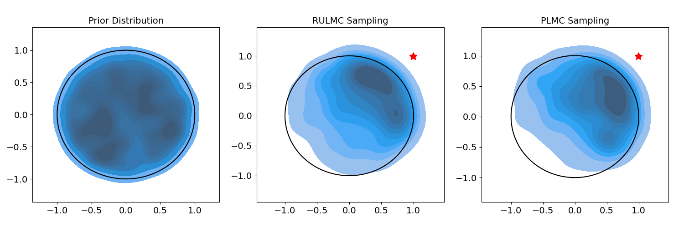

---
title: "Reflected Underdamped Langevin Monte Carlo"
image: fig1.png
author: 
  - Hengrong Du
  - Qi Feng
  - Mert Gurbuzbalaban
  - Mohammad Rafiqul Islam
  - Lingjiong Zhu
date: "3/15/2025"
---  

Ongoing research. The details will be available soon.  

  


```{=html}
<div class="share-row"><span>Share:</span><a href="https://www.facebook.com/sharer.php?u=https://rispace.github.io/research/rulmc/"><i class="bi bi-facebook"></i> Facebook</a><a href="https://www.linkedin.com/sharing/share-offsite/?url=https://rispace.github.io/research/rulmc/"><i class="bi bi-linkedin"></i> LinkedIn</a><a href="https://twitter.com/intent/tweet?url=https://rispace.github.io/research/rulmc/"><i class="bi bi-twitter"></i> Twitter</a></div>
```
<script src="https://giscus.app/client.js"
        data-repo="mrislambd/rispace.github.io" 
        data-repo-id="R_kgDOMV8crA"
        data-category="Announcements"
        data-category-id="DIC_kwDOMV8crM4CjbQW"
        data-mapping="pathname"
        data-strict="0"
        data-reactions-enabled="1"
        data-emit-metadata="0"
        data-input-position="bottom"
        data-theme="light"
        data-lang="en"
        crossorigin="anonymous"
        async>
</script>
 
<div id="fb-root"></div>
<script async defer crossorigin="anonymous"
 src="https://connect.facebook.net/en_US/sdk.js#xfbml=1&version=v20.0"></script>
<div class="fb-comments" data-href="https://rispace.github.io/research/rulmc/" data-width="750" data-numposts="5"></div>